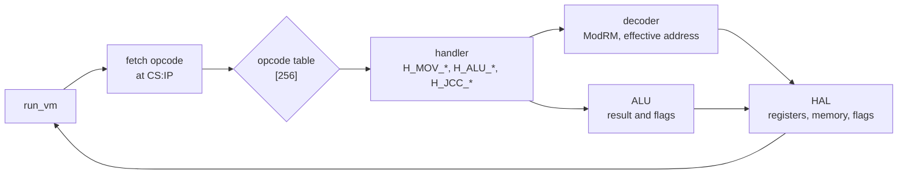
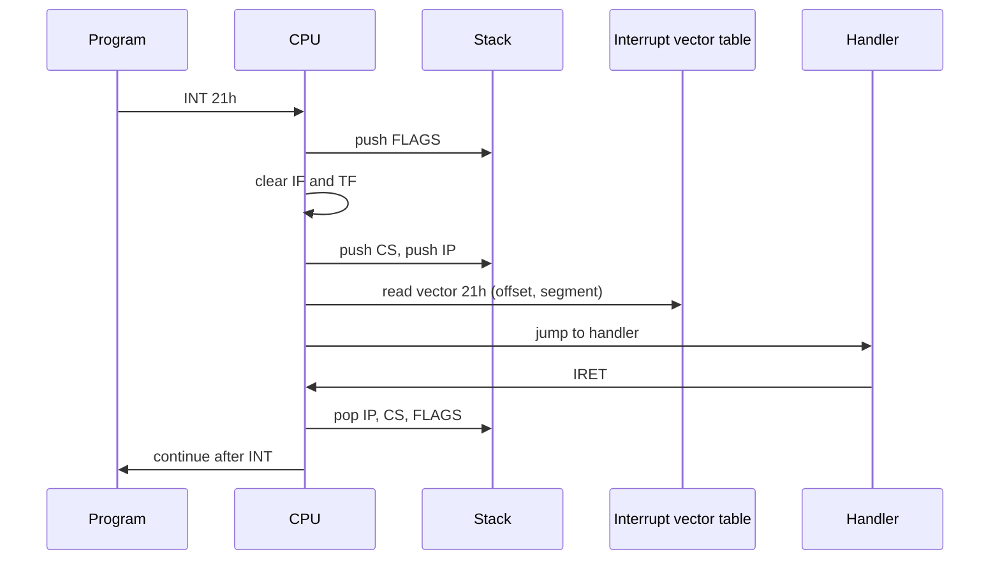

# cpu_model

An Intel 8086 CPU emulator written in C.


The emulator loads 16-bit 8086 machine code into a 1 MB address space and runs it instruction by instruction. For each instruction, it:

1. fetches the opcode at `CS:IP`
2. decodes the ModRM byte and any displacement
3. computes the effective address
4. executes the instruction, updating registers, memory and flags

## Features

- 155 of the 256 primary opcodes, dispatched through a 256-entry handler table
- `MOV` in all of its forms: register, immediate, r/m, segment register, accumulator ↔ memory offset
- `ADD`, `OR`, `ADC`, `SBB`, `AND`, `SUB`, `XOR`, `CMP` in all six encodings, plus the immediate groups `80`, `81` and `83`
- `INC` and `DEC`, which leave `CF` unchanged as on the 8086
- `PUSH` and `POP` for registers, segment registers, memory operands and `FLAGS`
- All 16 conditional jumps
- Short, near, far and indirect `JMP` and `CALL`
- `RET` and `RETF`, with an optional immediate
- `LOOP`, `LOOPZ`, `LOOPNZ` and `JCXZ`
- `INT n` through an interrupt vector table at `0000:0000`, and `IRET`
- `CF`, `PF`, `AF`, `ZF`, `SF` and `OF` computed per the Intel documentation
- All eight ModRM addressing modes, including the default `SS` segment for `BP`-based addresses

## Build and run

You need a C11 compiler (gcc or clang) and make.

```bash
git clone https://github.com/leehushacht/cpu_model.git
cd cpu_model
make run
```

`main.c` loads a built-in test program of hand-assembled 8086 code that covers each implemented instruction family. It includes an `INT 21h` call to a handler installed in the interrupt vector table. The program prints the CPU state before and after the run:

```text
AX=0000 BX=0000 CX=0000 DX=0000 SI=0000 DI=0000 SP=FF00 ES=0700 IP=0100
CF=0 ZF=0 SF=0 OF=0 PF=0 AF=0
mem[DS:0200]=0000 mem[DS:0202]=00 mem[DS:0210]=0000 mem[DS:0220]=0000
AX=0201 BX=0006 CX=1234 DX=F203 SI=0000 DI=F003 SP=FF00 ES=0800 IP=0410
CF=1 ZF=0 SF=0 OF=0 PF=0 AF=0
mem[DS:0200]=CDAB mem[DS:0202]=59 mem[DS:0210]=CDAB mem[DS:0220]=0701
```

In `main.c`, each instruction has its expected result written next to it as a comment.

## How it works

### Instruction cycle



### The ModRM byte

Most instructions that take a register or memory operand are followed by a ModRM byte. The decoder splits it into three fields:

```text
   7    6    5    4    3    2    1    0
 ┌─────────┬──────────────┬──────────────┐
 │   mod   │     reg      │     r/m      │
 └─────────┴──────────────┴──────────────┘
```

- **`mod`** selects register mode, or memory mode with no, 8-bit or 16-bit displacement.
- **`reg`** selects a register. In the group opcodes (`80`–`83`, `FE`, `FF`) it selects the operation instead.
- **`r/m`** selects a register, or the base and index registers of the memory operand.

### Memory map

```text
 00000h ┌──────────────────────────┐
        │ Interrupt vector table   │
 00400h ├──────────────────────────┤
        │ BIOS data area           │
 00500h ├──────────────────────────┤
        │ Program area             │
 A0000h ├──────────────────────────┤
        │ VGA graphics memory      │
 B8000h ├──────────────────────────┤
        │ Text-mode video memory   │
 F0000h ├──────────────────────────┤
        │ System / BIOS            │
 FFFFFh └──────────────────────────┘
```

A physical address is computed from a segment and an offset as `segment × 16 + offset`.

### Software interrupts



### Modules

| Module | Files | Responsibility |
|---|---|---|
| VM core | `vm.c`, `vm.h` | Machine lifecycle, the fetch/execute loop, the stack |
| HAL | `hal.c`, `hal.h` | Access to registers, memory and flags, and segment:offset translation |
| Decoder | `decode.c`, `decode.h` | ModRM parsing, effective addresses, r/m reads and writes |
| ALU | `alu.c`, `alu.h` | 8- and 16-bit arithmetic and logic, with flag updates |
| Opcode table | `opcodes.c` | Builds the dispatch table; group dispatchers (`FE`, `FF`) and `HLT` |
| Handlers | `ops_mov.c`, `ops_alu.c`, `ops_stack.c`, `ops_control.c` | One handler per instruction form, grouped by family |

Naming and layering rules are documented in [`rules.txt`](rules.txt). There are two kinds of function:

- **Handlers** are called from the opcode table and named after the instruction and its operand form, such as `H_MOV_rm8_r8` or `H_JCC_rel8`.
- **Operations** are everything else, named in snake_case, such as `decode_mod_rm` or `push16`.

## Project structure

```text
cpu_model/
├── main.c          # sets up the VM, loads the test program, prints CPU state
├── Makefile
├── rules.txt       # naming and layering conventions
├── to_do.txt
└── machine/
    ├── vm.c, vm.h
    ├── hal.c, hal.h
    ├── internal.h          # VM struct and memory map
    ├── decode.c, decode.h
    ├── alu.c, alu.h
    ├── opcodes.c, opcodes.h
    ├── ops.h
    ├── ops_mov.c
    ├── ops_alu.c
    ├── ops_stack.c
    └── ops_control.c
```

## Roadmap

- [x] Registers, segmented memory and flags
- [x] `MOV`, ALU operations, `INC` / `DEC`
- [x] Stack, jumps, calls, returns and loops
- [x] Software interrupts (`INT n` / `IRET`)
- [ ] Hardware interrupts
- [ ] A loader for DOS `.COM` programs
- [ ] Shifts and rotates, `MUL` / `DIV` (groups `D0`–`D3`, `F6`/`F7`)
- [ ] String instructions and `REP` prefixes
